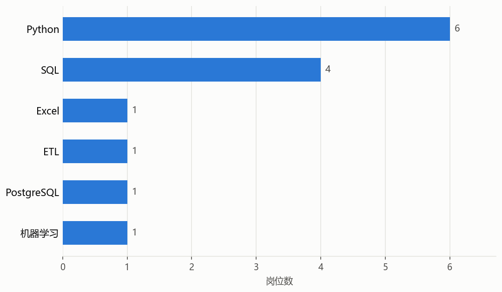

# Job Insight Lab｜岗位数据分析与报告工具 v2.2.0

[English](README.en.md) · Python 3.10+ · MIT

基于 [eatmoreduck/boss-zhipin-scraper](https://github.com/eatmoreduck/boss-zhipin-scraper) 扩展，面向求职时的岗位研究与工程能力展示。本仓库重点展示 JD 结构化、历史结果恢复和离线统计报告。

把职位列表与完整岗位描述转成可以比较的字段，再生成薪资、经验、学历、地区、技能和 JD 高频词六类图表。仓库附带合成数据，下载后可直接阅读结果，也可在本地复现，无需登录招聘平台。

## 先看演示

示例全部为虚构岗位和公司，不包含真实招聘者信息或登录数据。

- [职位列表示例](examples/boss_jobs_demo.json) 与 [结构化 JD 示例](examples/boss_details_demo.json)
- [统计结果](examples/report_stats.json)
- [完整图表目录](examples/charts)



## 本仓库的扩展

| 工程问题 | 实现与结果 | 代码位置 |
|---|---|---|
| JD 是长文本，难以直接比较职责与条件 | 保留完整 `jd`，提取 `job_responsibilities`、`job_requirements`、工作时间等字段；用 `work_info` 和 `detail_sections` 保留尚未归一化的信息 | [boss_cdp_raw.py](scripts/boss_cdp_raw.py) |
| 历史结果缺少新字段，重新采集成本高 | 加载旧 JSON 时从已有 JD 回填结构字段，无需重新访问详情页 | [boss_cdp_raw.py](scripts/boss_cdp_raw.py) |
| 详情失败重试可能覆盖成功数据 | 按岗位标识合并详情，保留有效 JD；记录失败状态；登录失效或安全校验时停止详情流程并保存累计结果 | [boss_cdp_raw.py](scripts/boss_cdp_raw.py) |
| 原始 JSON 不便于展示岗位需求 | 生成六类聚合图表和统计 JSON，附带离线合成样例 | [report_gen.py](scripts/report_gen.py) |

Chrome CDP 连接、列表响应捕获、城市码表和基础 CLI 来自原项目。本仓库沿用这些采集能力，在其上完善详情数据处理与报告展示。

## 本地复现离线报告

建议在 Python 虚拟环境中运行。Windows 可用 `python -m venv .venv` 创建环境，再运行 `.venv\Scripts\Activate.ps1`；macOS/Linux 使用 `source .venv/bin/activate`。

```bash
git clone https://github.com/gujiuji-1/job-insight-lab.git
cd job-insight-lab
python -m pip install -r requirements-report.txt
python scripts/report_gen.py --result-dir examples
```

命令读取 `examples/` 下的合成 JSON，新结果输出到 `report/stats.json` 和 `report/charts/`。`examples/` 中的文件是已提交的固定预览，`report/` 是被 Git 忽略的本地输出目录。

报告只统计输入样本：薪资按原始标签计数，技能按岗位标签计数，JD 高频词按文本出现次数计数；样本不能代表招聘市场整体。

生成文字摘要及可复制的岗位研究提示词：

```bash
python scripts/job_summary.py --input examples/boss_jobs_demo.json --details examples/boss_details_demo.json --top 10
```

`job_summary.py` 在本地读取 JSON 并生成文本，不会调用模型接口。

## 可选：在自己的浏览器中采集

需要 Chrome、Python 3.10+ 和本人可访问的 BOSS直聘账号。以下命令会连接浏览器并访问招聘平台；先阅读参数及平台规则，再自行运行。

```bash
python -m pip install -r requirements.txt
python scripts/boss_cdp_raw.py --setup-chrome
python scripts/boss_cdp_raw.py --keyword "Python" --city 上海 --pages 1 --max-details 5 --analysis
python scripts/boss_cdp_raw.py --stop-chrome
```

首次启动需要在专用 Chrome 中手动登录。默认使用独立且持久的 `~/.boss-zhipin-scraper/chrome-profile`，不会自动复制主 Chrome 登录数据。列表通过 CDP `Network` 捕获真实搜索页面自身产生的 API 响应；详情只提取“职位描述”区域，避免将登录提示、招聘者卡片与推荐职位混入 JD。

| 常用参数 | 用途 |
|---|---|
| `--keyword` / `--city` | 关键词与城市名或城市代码，默认 AI Agent / 上海 |
| `--pages` / `--max-details` | 限制列表页数与详情数量，页数上限 10 |
| `--no-detail` | 只采集列表 |
| `--format csv` | 在 JSON 之外输出列表与详情 CSV |
| `--output` / `--detail-output` | 指定列表与详情输出文件 |
| `--merge FILE` | 合并已有列表并按岗位标识去重 |
| `--input FILE --analysis --no-detail` | 从已有列表及关联详情生成分析 |
| `--list-cities [关键词]` | 查看城市码表 |
| `--check` | 检查依赖、CDP 和登录状态，会访问平台 |
| `--stop-chrome` | 按专用 profile 匹配并关闭采集浏览器 |

完整选项可用 `python scripts/boss_cdp_raw.py --help` 查看。`--copy-login-state` 会复制主 Chrome 中的 Cookie 相关文件到专用 profile，仅在明确需要时使用；`--reset-chrome-profile` 会清除专用浏览器登录状态。

为兼容已有使用方式，安装后的命令仍为 `boss-scraper`、`boss-summary`，默认结果目录仍为 `~/.boss-zhipin-scraper/job-result`，版本保持 `2.2.0`。

## 验证与限制

测试采用标准库 `unittest` 与本地 mock，覆盖 JD 解析、历史字段回填、合并保留、异常状态和文字摘要。运行方式：

```bash
python -m unittest discover -s tests -p "test_*.py"
```

离线样例用于展示可复现的处理流程；真实 Chrome 登录、页面变动和平台限制仍需在使用环境中验证。本项目不承诺采集持续可用。只处理本人有权访问的数据，遵守招聘平台规则，不公开 Cookie、Token、浏览器 profile 或未经处理的个人信息。

## 文件结构

```text
job-insight-lab/
├── examples/                  # 合成 JSON、统计和图表
├── scripts/
│   ├── boss_cdp_raw.py        # CDP 采集与 JD 处理
│   ├── job_summary.py         # 文字摘要与提示词
│   └── report_gen.py          # 聚合统计与图表
├── tests/                     # 本地 mock 与离线测试
├── data/city_codes.json       # 城市码表
├── requirements.txt           # 采集依赖
├── requirements-report.txt    # 离线报告依赖
├── CONTRIBUTING.md
├── CHANGELOG.md
├── SKILL.md
└── LICENSE
```

## 来源与许可

原项目：[eatmoreduck/boss-zhipin-scraper](https://github.com/eatmoreduck/boss-zhipin-scraper)。原作者：**eatmoreduck**。原采集底座与基础工具在其 MIT 许可下使用，本仓库保留 [LICENSE](LICENSE) 中的原版权声明。

本仓库由 [gujiuji-1](https://github.com/gujiuji-1) 维护，用于展示基于开源项目完成的工程扩展。详情结构化、历史结果恢复和报告展示的改动可结合上述代码与测试审阅；上游能力与本仓库扩展在文档中分别说明。
